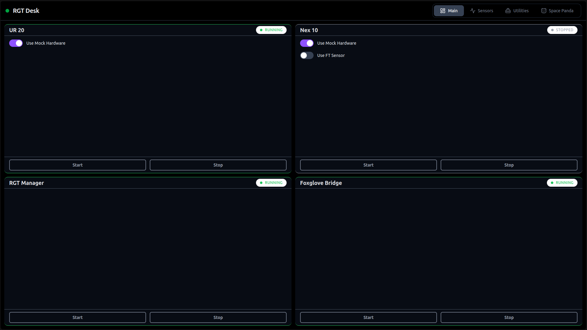
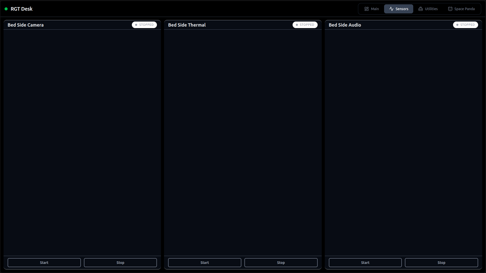
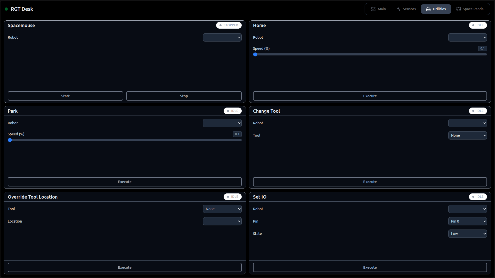
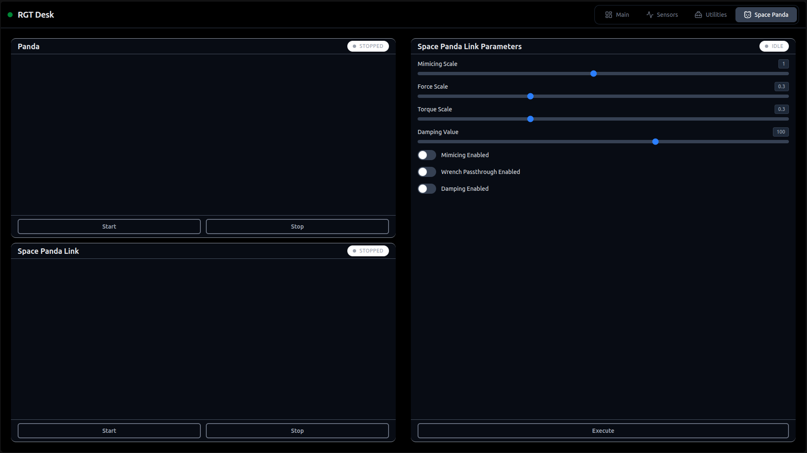

# rgt_desk
Absolutely life-changing dashboard experience unlike anything you have ever seen before. Truly eye-opening. Let's grind!









A dashboard for starting/stopping robot processes and calling robot services. A Vue 3 frontend talks to a FastAPI backend, which manages the ROS 2 (Jazzy) processes as tmux windows in a session named `rgt`. Both are run as systemd services.

# Dependencies

- **ROS 2 Jazzy** — the backend imports `rclpy`, `ur_dashboard_msgs`, and `controller_manager_msgs`, which come from the ROS install, and it sources `~/repos/ros2_ws/install/setup.bash` at startup, so that workspace must exist on the target machine.
- **tmux** — managed processes run as windows in the `rgt` tmux session.
- **Python 3** with the `venv` module.
- **Node.js** `^22.18.0 || >=24.12.0` — nvm or a system package both work; `./install.sh` makes the active one visible to systemd. Recommended via nvm:
```bash
nvm install 24
```

# Install

The systemd unit files hardcode `User=mfi` and the install path `/home/mfi/repos/rgt_desk`, so on the target machine clone the repo to that location as that user. Everything below assumes the repo is at `~/repos/rgt_desk`.

1. Clone this repo:
```bash
git clone https://github.com/alexmnr/rgt_desk.git ~/repos/rgt_desk
```

2. Run the install script (needs sudo). It creates the backend virtualenv and installs its Python dependencies, links the active `node`/`npm` into `/usr/local/bin` so the systemd unit can find them regardless of how Node was installed, installs the frontend dependencies and builds it, symlinks the unit files into `/etc/systemd/system`, then enables and starts both services:
```bash
cd ~/repos/rgt_desk && ./install.sh
```

3. Check the status of the frontend and backend:
```bash
sudo systemctl status rgt_desk_backend.service
sudo systemctl status rgt_desk_frontend.service
```

Note: the backend service sets `ROS_DOMAIN_ID=19`. If your robots use a different domain, edit `systemd_services/rgt_desk_backend.service`, then re-run `./install.sh` (or re-symlink manually and `sudo systemctl daemon-reload`).

# Run

- **Dashboard:** http://<host-ip>/ — the frontend serves on port 80 (all interfaces) and reaches the backend API on port 8000 of the same host. Both services bind to `0.0.0.0`, so any IP or hostname assigned to the machine works.
- **Follow service logs:**
```bash
journalctl -u rgt_desk_backend.service -f
journalctl -u rgt_desk_frontend.service -f
```
- **Watch the managed processes:** `tmux attach -t rgt` (Ctrl-b n to switch windows).

### Running without systemd (development)

Backend — run from inside `rgt_desk_backend/` (imports are flat and process scripts are invoked via relative paths), with the ROS environment sourced:
```bash
cd ~/repos/rgt_desk/rgt_desk_backend
source .venv/bin/activate
source /opt/ros/jazzy/setup.bash
source ~/repos/ros2_ws/install/setup.bash
uvicorn main:app --host 0.0.0.0 --port 8000
```

Frontend — hot-reload dev server:
```bash
cd ~/repos/rgt_desk/rgt_desk_frontend
npm install
npm run dev
```

# Update

The frontend service runs `npm install` and `npm run build` on every start, so no manual build is needed — a restart picks up all changes. Startup can take up to 2 minutes while it rebuilds.

```bash
cd ~/repos/rgt_desk
git pull
sudo systemctl restart rgt_desk_backend.service
sudo systemctl restart rgt_desk_frontend.service
```

If dependencies changed (`requirements.txt`, `package.json`), the restart handles the reinstall automatically.

### Adding a new process or service

The name is the glue: the script name, the backend branch, the status entry, and the panel `id` must all match (e.g. `lidar` below).

**1. Add the shell script** and make it executable (`chmod +x`). Dashboard params are passed as positional shell arguments (`$1`, `$2`, ...):

```bash
# process_scripts/lidar.sh — long-running: gets its own tmux window in the `rgt` session
ros2 launch sick_scan sick_scan.launch.py ns:=lidar
```
```bash
# service_scripts/grip.sh — one-shot: runs and exits
ros2 service call /$1/grip robot_manager_interfaces/srv/Grip "{force: $2}"
```

**2. Add a backend branch** in `rgt_desk_backend/api.py` — in `start_process`/`stop_process` for processes, or in `execute_service` for services. This is where params become script arguments:

```python
# start_process (and the same name check in stop_process)
elif req.name == "lidar":
    command = "../process_scripts/lidar.sh"
    tmux.start_process(req.name, command)

# execute_service
elif req.name == "grip":
    command = f"../service_scripts/grip.sh {req.params['ns']} {req.params['force']}"
    subprocess.run(command, shell=True, capture_output=False, text=False)
```

**3. Add the name to the `status` dict** in `rgt_desk_backend/process_monitor.py` (processes only — services don't need this). A process only shows `running` once its tmux window exists *and* a matching ROS node is visible, so launch your nodes with the process name in their namespace/name.

**4. Add a panel** in `rgt_desk_frontend/src/config/panels.json` under the right tab. Param `key`s must match the `req.params[...]` keys read in `api.py`:

```json
{ "type": "process", "id": "lidar", "title": "Lidar", "params": [] },
{ "type": "service", "id": "grip", "title": "Grip", "params": [
  { "key": "ns", "type": "select", "label": "Robot", "options": "robots" },
  { "key": "force", "type": "slider", "label": "Force", "min": 0.0, "max": 1.0, "step": 0.1, "default": 0.5 }
]}
```

Param types: `toggle`, `slider` (`min`/`max`/`step`), and `select` (`options` is either the name of a shared option set defined in `panels.json`, like `robots`, or an inline `[{label, value}]` array). The panel's `default` fields become the store's initial values. No other frontend code is needed — the card, its controls, and its defaults are all generated from the config.

**5. Restart both services** (as shown above) to pick up the backend and frontend changes.

# Uninstall

Stops and disables both services, removes the unit files, and deletes the venv, `node_modules`, and `dist`:
```bash
cd ~/repos/rgt_desk && ./uninstall.sh
```
