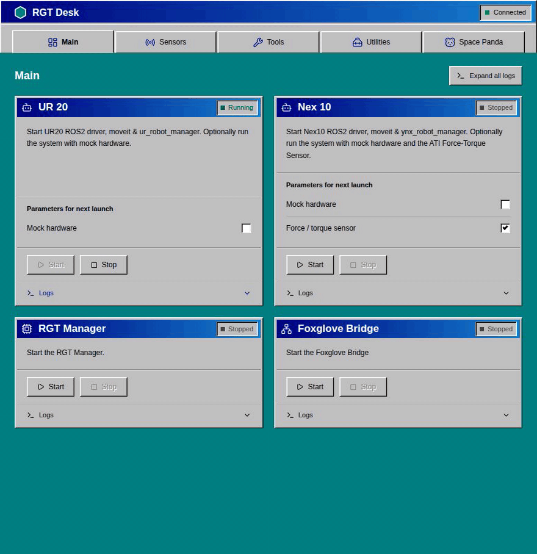

# RGT Desk
Absolutely life-changing dashboard experience unlike anything you have ever seen before. Truly eye-opening. Let's grind!

<!-- 


 -->



A dashboard for starting/stopping robot processes and calling robot services. A Vue 3 frontend talks to a FastAPI backend, which manages the ROS 2 (Jazzy) processes as tmux windows in a session named `rgt`. Both are run as systemd services.

# Dependencies

- **ROS 2 Jazzy** — the backend imports `rclpy`. Install ROS 2 Jazzy and source the ROS environment before running the backend manually.
- **tmux** — managed processes run as windows in the `rgt` tmux session.
- **Python 3** with the `venv` module.
- **Node.js** `^22.18.0 || >=24.12.0` — nvm or a system package both work; `./install.sh` makes the active one visible to systemd. Recommended via nvm:
```bash
nvm install 24
```

# Install

The install is user- and location-agnostic: `install.sh` renders the unit templates in `systemd_services/*.service.template` for whoever runs it, based on the directory the repo is cloned to. The only thing it asks for is the path to your ROS 2 workspace (default `~/repos/ros2_ws`; it must be built). Everything below assumes the repo is at `~/repos/rgt_desk`.

1. Clone this repo:
```bash
git clone https://github.com/alexmnr/rgt_desk.git ~/repos/rgt_desk
```

2. Run the install script (needs sudo). It creates the backend virtualenv and installs its Python dependencies, links the active `node`/`npm` into `/usr/local/bin` so the systemd unit can find them regardless of how Node was installed, installs the frontend dependencies and builds it, writes the rendered unit files into `/etc/systemd/system`, then enables and starts both services:
```bash
cd ~/repos/rgt_desk && ./install.sh
```

3. Check the status of the frontend and backend:
```bash
sudo systemctl status rgt_desk_backend.service
sudo systemctl status rgt_desk_frontend.service
```

Note: the backend service sets `ROS_DOMAIN_ID=19`. If your robots use a different domain, edit `systemd_services/rgt_desk_backend.service`, then re-run `./install.sh` (or re-symlink manually and `sudo systemctl daemon-reload`).

# Run

- **Dashboard:** http://<host-ip>/ — the frontend serves on port 80 (all interfaces) and reaches the backend API on port 8000 of the same host. Both services bind to `0.0.0.0`, so any IP or hostname assigned to the machine works.
- **Follow service logs:**
```bash
journalctl -u rgt_desk_backend.service -f
journalctl -u rgt_desk_frontend.service -f
```
- **Watch managed processes and service calls:** `tmux attach -t rgt` (Ctrl-b n to switch windows). Service calls use `service-<name>` windows that close after completion or cancellation. Their logs disappear when the window closes. The dashboard's service cards also provide live **Logs**, call status, and **Cancel call**. Cancellation stops the local client; the ROS server may continue work it has already accepted.

### Running without systemd (development)

From the repository root, run each script in a separate terminal. Source your ROS 2 environment before starting the backend:
```bash
./rgt_desk_backend/run.sh
./rgt_desk_frontend/run.sh
```

The backend creates or reuses `.venv`, installs `requirements.txt`, and starts uvicorn. ROS 2 and its message packages, Python with venv support, and tmux must already be installed. The virtual environment includes system packages so ROS Python dependencies remain available.

The frontend requires Node.js/npm, installs dependencies with `npm ci`, builds the app, and serves it at **http://localhost:5173**. The backend defaults to port **8000** and `ROS_DOMAIN_ID=19`. Both bind to `0.0.0.0`; override `BIND_HOST` or `PORT` per command, for example `PORT=8080 ./rgt_desk_frontend/run.sh`. Extra arguments go to uvicorn or Vite preview. Stop either with Ctrl-C.

For frontend hot reload, run `npm run dev -- --host 0.0.0.0` from `rgt_desk_frontend/` after the first setup.

### Embedded Foxglove viewer

The **Foxglove** tab embeds the official Foxglove viewer. It requires an embedding-enabled Foxglove organization (such as Pro, Academic, or Enterprise) and internet access to `https://embed.foxglove.dev/`. See the [Foxglove embedding guide](https://docs.foxglove.dev/docs/embed/typescript-sdk).

1. Open RGT Desk through **localhost** on the robot host, or through **HTTPS** for LAN access. Ordinary `http://<host-ip>/` access still works for the other tabs; the Foxglove tab explains the secure-context requirement instead of loading a broken viewer.
2. Start **Foxglove Bridge** on Main. The existing process script starts its normal WebSocket endpoint on port **8765**.
3. Open **Foxglove**, confirm the bridge URL, optionally enter your Foxglove organization slug, and click **Open viewer** after changing settings. Sign in to your embedding-enabled account inside the viewer. Leaving the organization blank lets you choose one during sign-in.

For localhost access, the default bridge URL is `ws://localhost:8765`. For HTTPS access, the tab defaults to `wss://<page-hostname>:8765`; configure a trusted TLS endpoint for the bridge (for example a WebSocket reverse proxy) and enter its actual URL. The current bridge script does not configure TLS. The browser must be able to reach that endpoint. When serving the frontend over HTTPS, also provide a trusted HTTPS endpoint for the backend on port 8000, which the existing API client derives from the page's protocol and hostname. This change does not configure TLS for the frontend, backend, or bridge.

Connection settings are remembered in this browser when storage is available, and Foxglove stores layout edits under the `rgt-desk` layout key. Opening the tab loads the viewer; leaving it releases the iframe and its connection without stopping the ROS bridge. With a compatible viewer, the SDK keeps the WebSocket in RGT Desk's browser context. Older viewers can connect directly to `wss://` endpoints; local `ws://` connections require parent-owned transport support.

To set deployment defaults, put these optional public build settings in `rgt_desk_frontend/.env.local` and rebuild. Browser-saved settings take precedence. These values are not secrets; authentication stays in Foxglove.

```dotenv
VITE_FOXGLOVE_ORG_SLUG=your-organization
VITE_FOXGLOVE_BRIDGE_URL=wss://desk.example.org/foxglove-bridge
```

# Update

The frontend service runs `npm install` and `npm run build` on every start, so no manual build is needed — a restart picks up all changes. Startup can take up to 2 minutes while it rebuilds.

```bash
cd ~/repos/rgt_desk
git pull
sudo systemctl restart rgt_desk_backend.service
sudo systemctl restart rgt_desk_frontend.service
```

If dependencies changed (`requirements.txt`, `package.json`), the restart handles the reinstall automatically.

### Adding a new process or service

No Python changes needed. The name is the glue: the script name, the tmux window, the status key, the `config.json` key, and the panel `id` must all match (e.g. `lidar` below).

**1. Add the shell script** and make it executable (`chmod +x`). Dashboard params are passed as positional shell arguments (`$1`, `$2`, ...):

```bash
# process_scripts/lidar.sh — long-running: gets its own tmux window in the `rgt` session
ros2 launch sick_scan sick_scan.launch.py ns:=lidar
```
```bash
# service_scripts/grip.sh — one-shot: runs in service-grip; window closes after exit
ros2 service call /$1/grip robot_manager_interfaces/srv/Grip "{force: $2}"
```

**2. Add a command template** to `rgt_desk_backend/config.json` — one `{placeholder}` per dashboard param. Values are stringified (Python `true` → `True`, which the ros2 CLI expects) and shlex-quoted; an optional `coerce` map forces `"float"`/`"int"` literals where a script needs them (e.g. ros2 double params):

```json
{ "processes": { "lidar": { "command": "../process_scripts/lidar.sh" } },
  "services":  { "grip":  { "command": "../service_scripts/grip.sh {ns} {force}",
                            "coerce": { "force": "float" } } } }
```

A process only shows `running` once its tmux window exists *and* a matching ROS node is visible, so launch your nodes with the process name in their namespace/name.

**3. Add a panel** in `rgt_desk_frontend/src/config/panels.json` under the right tab. Param `key`s must match the `{placeholder}`s in `config.json`:

```json
{ "type": "process", "id": "lidar", "title": "Lidar", "params": [] },
{ "type": "service", "id": "grip", "title": "Grip", "params": [
  { "key": "ns", "type": "select", "label": "Robot", "options": "robots" },
  { "key": "force", "type": "slider", "label": "Force", "min": 0.0, "max": 1.0, "step": 0.1, "default": 0.5 }
]}
```

Param types: `toggle`, `slider` (`min`/`max`/`step`), and `select` (`options` is either the name of a shared option set defined in `panels.json`, like `robots`, or an inline `[{label, value}]` array). The panel's `default` fields become the store's initial values. No other frontend code is needed — the card, its controls, and its defaults are all generated from the config.

Select controls use side-by-side buttons for up to four options by default. Add `"display": "segmented"` to keep the buttons as the option list grows; they wrap to fit the panel. Both tool selectors use this setting.

To reassign panes, move their complete objects between `tabs.main.panels`, `tabs.sensors.panels`, `tabs.tools.panels`, `tabs.utilities.panels`, and `tabs.space_panda.panels` in `rgt_desk_frontend/src/config/panels.json`. Array order controls display order. Keep each pane's `id` unchanged and unique across tabs; its parameters, defaults, actions, and status follow it automatically. Each tab also sets its own `columns` and `logs`. Tools starts empty so you can choose its contents. Rebuild the frontend after editing when using the preview server; Vite development mode reloads automatically.

**4. Restart both services** (as shown above) to pick up the backend and frontend changes.

# Uninstall

Stops and disables both services, removes the unit files, and deletes the venv, `node_modules`, and `dist`:
```bash
cd ~/repos/rgt_desk && ./uninstall.sh
```
